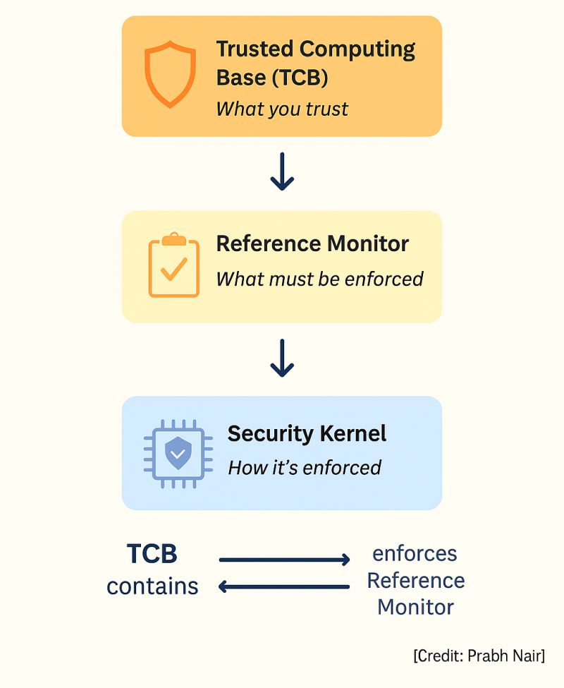
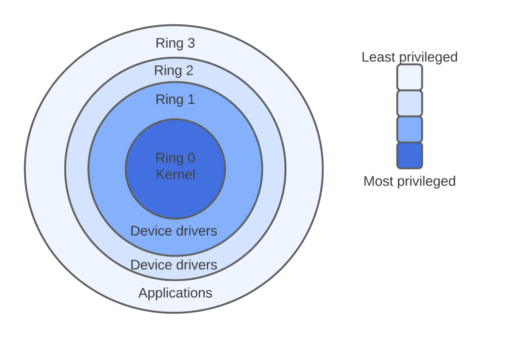

---
layout:
  width: default
  title:
    visible: true
  description:
    visible: false
  tableOfContents:
    visible: true
  outline:
    visible: true
  pagination:
    visible: false
  metadata:
    visible: true
  tags:
    visible: true
  actions:
    visible: true
  anchors:
    visible: true
---

# Trusted Computing Base


#### Quick Definition

The Trusted Computing Base (TCB) is the set of hardware, firmware and software in a system that we have no choice but to trust, because if any part of it fails or is compromised, none of the system's other security controls can be relied upon.


## Overview

The authoritative definition (CNSSI 4009, used by NIST) describes the TCB as:

> The totality of protection mechanisms within a computer system, including hardware, firmware, and software, the combination responsible for enforcing a security policy.

In practice, the TCB is the minimal, core set of hardware and operating system functions that provides a reliable, protected foundation for everything else. It is the part of the system that stops user-mode programs from gaining privileged status, which would let them manipulate hardware directly, bypass access controls, or interfere with other processes.

Every security control we add higher up the stack (antivirus, file permissions, application allow-listing, a SIEM agent) is ultimately _asking the TCB_ to enforce something. If the TCB is compromised, those controls are only as trustworthy as the thing an attacker now controls.

### The Concept

<mark style="color:$info;">The TCB is a</mark> <mark style="color:$info;"></mark><mark style="color:$info;">**boundary you draw**</mark> around the components of a system that must work correctly for the system's security policy to hold.

Because it is a boundary, the TCB is **managed** rather than deployed. We:

1. **Identify** it: which components must I trust on this platform?
2. **Minimise** it: trust as few components as possible.
3. **Protect** it: isolate it from everything outside the boundary.
4. **Control changes** to it: supply chain, configuration management and change approval.


#### Practitioner Analogy

Tier 0 in the Active Directory tiering model (domain controllers, Domain Admins, AD CS, Entra Connect) is effectively the TCB of your identity system. Compromise Tier 0 and every downstream control becomes untrustworthy, which is exactly why Tier 0 is kept small, isolated, and tightly change-controlled. An endpoint's TCB works on the same logic.


### "Trusted" Does Not Mean "Trustworthy"

This is the single most important idea for understanding the TCB, and the one most often misunderstood.

* In everyday language, _trusted_ means "reliable, worthy of confidence".
* In computer security, _trusted_ means **"**<mark style="color:$info;">**security-critical: we are forced to rely on it**</mark>**"**.

A trusted component is one we **have** to trust, regardless of whether we **can** or **should**. The term says nothing about whether the component is actually secure. A buggy kernel driver running in ring 0 is still part of the TCB; it is just a bad part of it.

This is why every component inside the TCB deserves _extra_ scrutiny, not less, and why a smaller TCB is a better TCB.

### Trust Is Inherited

If a component is in the TCB, <mark style="color:$info;">**so is every component it depends on**</mark>, because if those dependencies fail, it cannot be guaranteed to work either.

The kernel depends on its drivers, which depend on the firmware that loaded them, which depends on the CPU and the boot ROM. That chain is why the TCB of a modern laptop extends from the silicon all the way up to security-critical services in the operating system.

***

## Key Terms

<table><thead><tr><th width="170">Term</th><th width="260">What It Is</th><th width="130">Type</th><th>Example</th></tr></thead><tbody><tr><td><strong>Trusted Computing Base</strong></td><td>Everything (hardware, firmware, software) responsible for enforcing the security policy.</td><td><mark style="color:$info;">Boundary</mark></td><td>CPU, UEFI firmware, hypervisor, kernel, drivers, LSASS on a Windows laptop.</td></tr><tr><td><strong>Reference Monitor</strong></td><td>An abstract machine that mediates <em>every</em> access by a subject to an object.</td><td><mark style="color:$info;">Concept</mark></td><td>The idea that "something must check every file open against the ACL".</td></tr><tr><td><strong>Security Kernel</strong></td><td>The hardware, firmware and software that <em>implement</em> the reference monitor.</td><td><mark style="color:$success;">Component</mark></td><td>The Windows Security Reference Monitor, SELinux in the Linux kernel.</td></tr><tr><td><strong>Security Perimeter</strong></td><td>The imaginary line separating the TCB from everything outside it.</td><td><mark style="color:$info;">Boundary</mark></td><td>The user-mode / kernel-mode transition (system call interface).</td></tr><tr><td><strong>Trusted Path</strong></td><td>A protected communication channel between the <em>user</em> and the TCB that cannot be imitated or intercepted.</td><td><mark style="color:$success;">Mechanism</mark></td><td>Ctrl+Alt+Del (Secure Attention Sequence) before the Windows logon screen.</td></tr><tr><td><strong>Trusted Channel</strong></td><td>A protected communication channel between the TCB and another trusted system.</td><td><mark style="color:$success;">Mechanism</mark></td><td>A mutually authenticated, encrypted link between two trusted systems.</td></tr><tr><td><strong>Trusted Platform Module (TPM)</strong></td><td>A dedicated security chip providing a hardware root of trust (key storage, boot measurements, attestation).</td><td><mark style="color:$success;">Component</mark></td><td>A TPM 2.0 chip sealing BitLocker keys to a known-good boot state.</td></tr></tbody></table>


#### TCB vs TPM

The TCB is a _boundary_; the TPM is a _chip_.

A TPM is commonly part of a modern TCB, but a system can have a TCB without a TPM.



#### The relationship in one line

The reference monitor is the idea, the security kernel is its implementation, and the TCB contains the security kernel plus every other protection mechanism the system relies on.



***

## The Reference Monitor

The reference monitor concept was introduced in the **Anderson Report (1972)**, a US Air Force study into how multiple users with different clearances could safely share one computer. It describes an abstract machine that sits between every **subject** (a user or process) and every **object** (a file, memory page, device or socket) and decides whether each access is allowed.

Any implementation of a reference monitor (a _reference validation mechanism_) must meet three requirements:

<table><thead><tr><th width="190">Property</th><th width="300">Requirement</th><th>Fails When…</th></tr></thead><tbody><tr><td><strong>Complete Mediation</strong> (always invoked)</td><td>Every access to every object is checked, every time. There is no route around it.</td><td>An old API, a cached handle, or a debug interface lets a process reach an object without the check.</td></tr><tr><td><strong>Tamper-Proof</strong> (isolation)</td><td>The mechanism itself cannot be modified or disabled by anything it is supervising.</td><td>Malware loads a kernel driver and patches out the access check.</td></tr><tr><td><strong>Verifiable</strong> (small enough to analyse)</td><td>It is small and simple enough to be tested and analysed so its correctness can be assured.</td><td>The enforcement logic is spread across millions of lines of code nobody can fully review.</td></tr></tbody></table>

### How the Reference Monitor Responds to Violations

The reference monitor's normal job is simply to **deny** an unauthorised access: the process asks to read a file it has no rights to, and the request fails.

If the reference monitor detects a violation, such as one user-mode program attempting to access RAM or CPU registers allocated to another, it can and will **shut down the system** rather than allow the violation to escalate. <mark style="color:$info;">This reflects a</mark> <mark style="color:$info;"></mark><mark style="color:$info;">**fail-secure**</mark> <mark style="color:$info;"></mark><mark style="color:$info;">design</mark>: when the integrity of the TCB itself is in doubt, stopping is safer than continuing in an unknown state.

<mark style="color:$info;">**Implementation Example:**</mark> Windows Kernel Patch Protection (PatchGuard) monitors critical kernel structures. If it detects that they have been modified, it deliberately crashes the system (bug check `0x109 CRITICAL_STRUCTURE_CORRUPTION`) rather than keep running with a tampered kernel.

***

## The Security Kernel

The security kernel is the hardware, firmware and software inside the TCB that actually implements the reference monitor. To be effective it must meet the same three properties: mediate all accesses, be protected from modification, and be verifiable as correct.

The security kernel sits within the operating system kernel, which contains the fundamental, core elements of the OS. These typically include the functions that:

* Create and manage processes and process IDs.
* Manage main memory used by each process.
* Manage virtual memory and paging.
* Manage the CPU and other essential hardware subsystems.

<mark style="color:$info;">**Implementation Example:**</mark> On Windows, the **Security Reference Monitor (SRM)** is a component of the kernel-mode Executive. Whenever a process opens an object, the SRM compares the process's access token against the object's security descriptor and allows or denies the request. See the [Windows Internals](../../reverse-engineering/windows-internals/) page for where the SRM sits in the kernel architecture.

### Monolithic vs Microkernel

The _verifiable_ requirement drives a long-running design debate:

<i class="fa-chevron-down" style="color:$danger;">:chevron-down:</i> <mark style="color:$danger;">**Monolithic kernels**</mark> (Linux, largely Windows) run drivers, file systems and networking in kernel mode. Fast, but the TCB is enormous, so a bug in any driver is a bug in the TCB.

<i class="fa-chevron-up" style="color:$success;">:chevron-up:</i> <mark style="color:$success;">**Microkernels**</mark> run only the bare minimum in kernel mode and push everything else into user mode. The TCB is far smaller and can even be formally verified (the seL4 microkernel has a mathematical proof of correctness), at some cost to performance and compatibility.

***

## Isolation & Trusted Paths

The TCB is the lowest-level enforcer of access control policies. It enforces them by establishing and preserving the **separation of memory and CPU resources** used by one process thread, so they cannot be read, modified, or called into execution by another process.

### Protection Rings

CPUs provide hardware privilege levels, usually drawn as concentric rings. Code in an inner ring can do things code in an outer ring cannot.

<figure><figcaption></figcaption></figure>

<table><thead><tr><th width="120">Ring</th><th width="200">Mode</th><th>What Runs There</th></tr></thead><tbody><tr><td><strong>Ring -1</strong> (informal)</td><td>Hypervisor</td><td>Hyper-V, VMware ESXi, KVM. Controls the operating systems themselves.</td></tr><tr><td><strong>Ring 0</strong></td><td>Kernel / supervisor mode</td><td>OS kernel, security kernel, device drivers. Full access to memory and hardware.</td></tr><tr><td><strong>Rings 1-2</strong></td><td>Rarely used</td><td>Historically drivers or OS services; most modern OSs skip these.</td></tr><tr><td><strong>Ring 3</strong></td><td>User mode</td><td>Applications, browsers, Office. Must ask the kernel (via system calls) to touch hardware or other processes.</td></tr></tbody></table>

The boundary between ring 3 and ring 0 is where the **security perimeter** usually sits on a single machine. A user-mode program that wants to open a file, allocate memory or talk to a device must cross that boundary through a controlled interface (a system call), where the security kernel can check the request.

**Privilege escalation** is, at its core, an attack on this boundary: getting code you control to run inside the perimeter.

### Supporting Isolation Techniques

* **Process isolation:** each process gets its own virtual address space and cannot see another process's memory.
* **Memory protection:** the CPU's memory management unit enforces page permissions (read, write, execute) set by the kernel.
* **Layering:** functionality is organised into layers that only talk to adjacent layers through defined interfaces.
* **Data hiding:** a layer's internal data is inaccessible to other layers.
* **Abstraction:** complex operations are hidden behind simple interfaces, reducing what each layer needs to trust.

### Trusted Paths and Trusted Channels

The TCB also creates and controls **trusted paths**, protected routes that cannot be intercepted, imitated or tampered with by untrusted code.

* A **trusted path** links the **user** to the TCB. Its purpose is to guarantee that when you type your password, you are talking to the real operating system and not a fake login screen.
* A **trusted channel** links the TCB to **another trusted system** (for example, a mutually authenticated, encrypted link).

The TCB manages trusted paths between processes and hardware devices by means of their device drivers and service handlers. This is the same idea applied inside the machine: user-mode code never talks to hardware directly, only through the TCB's controlled interfaces.

<mark style="color:$info;">**Implementation Example:**</mark> Pressing **Ctrl+Alt+Del** before logging on to Windows is a _Secure Attention Sequence_. The key combination is intercepted by the kernel and cannot be captured by any user-mode application, so whatever appears afterwards is guaranteed to be the genuine Windows logon interface rather than a password-stealing imitation.

The separation of process resources and the management of trusted paths are fundamental to preventing privilege escalation and unauthorised access at the most foundational level of the system. Without a functioning TCB, the security guarantees of higher-level software controls have no reliable foundation.

***

## What's Inside a Modern TCB

The TCB typically consists of the TPM, the reference monitor and elements of the OS kernel. More precisely, a modern TCB is a **layered stack**, where each layer depends on (and is verified by) the one beneath it. This chain is often called the **chain of trust**.

<table><thead><tr><th width="200">Layer</th><th width="280">Examples</th><th>Role in the TCB</th></tr></thead><tbody><tr><td><strong>Hardware Root of Trust</strong></td><td>CPU, boot ROM, TPM, Secure Enclave / Pluton</td><td>Immutable starting point. Stores keys and records boot measurements that cannot be faked by software.</td></tr><tr><td><strong>Firmware</strong></td><td>UEFI / BIOS, Secure Boot, device firmware</td><td>Initialises hardware and verifies the signature of the bootloader before handing over control.</td></tr><tr><td><strong>Hypervisor</strong></td><td>Hyper-V (including VBS), ESXi, KVM</td><td>Isolates operating systems from each other and, with VBS, isolates security functions from the OS kernel itself.</td></tr><tr><td><strong>OS Kernel &#x26; Drivers</strong></td><td>ntoskrnl.exe, Linux kernel, all ring 0 drivers</td><td>Contains the security kernel. Every kernel-mode driver is inside the TCB, including third-party ones.</td></tr><tr><td><strong>Security-Critical Services</strong></td><td>LSASS, Winlogon, EDR agents, disk encryption</td><td>Authenticate users, hold credentials, enforce policy. Run with high privilege and are trusted by everything else.</td></tr></tbody></table>

### Secure Boot vs Measured Boot

Two commonly confused mechanisms that protect the bottom of the stack:

* **Secure Boot** _verifies_: each stage checks the digital signature of the next and refuses to run anything unsigned or untrusted. It **prevents** tampered boot components from running.
* **Measured Boot** _records_: each stage hashes the next and stores the measurement in the TPM's Platform Configuration Registers (PCRs). It doesn't block anything, but it lets the device **prove** (attest) exactly what booted, and lets the TPM release secrets (such as BitLocker keys) only if the measurements match a known-good state.

### Isolating the TCB from Itself: VBS and HVCI

Because the Windows kernel and its drivers form such a large TCB, Microsoft uses the hypervisor to carve out a smaller, more trustworthy enclave:

* **Virtualization-Based Security (VBS)** uses the hypervisor to create an isolated memory region that the normal kernel cannot access, even if the kernel is compromised.
* **Hypervisor-Protected Code Integrity (HVCI / Memory Integrity)** moves the code-integrity checks into that isolated region, so only properly signed code can execute in kernel mode, and the checks cannot be patched out by a kernel-mode attacker.
* **Credential Guard** moves LSASS secrets into the isolated region, so dumping LSASS memory no longer yields usable credential material.

This is a direct application of TCB thinking: if the big TCB (the kernel) cannot be made small and verifiable, put the most critical functions inside a _smaller_ TCB that it cannot touch.

***

## Design Principles

A well-designed TCB follows a small set of principles, which also appear in NIST SP 800-160 Vol. 1 (_Engineering Trustworthy Secure Systems_) and NIST SP 800-53 control **SA-8**.

<table><thead><tr><th width="200">Principle</th><th>What It Means for the TCB</th></tr></thead><tbody><tr><td><strong>Minimisation</strong></td><td>Keep the TCB as small and simple as possible. Every line of code inside it is a potential flaw that compromises everything. (NIST: <em>minimised security elements</em>, <em>reduced complexity</em>.)</td></tr><tr><td><strong>Isolation</strong></td><td>The TCB must be protected from interference by anything outside the security perimeter.</td></tr><tr><td><strong>Complete Mediation</strong></td><td>Every access to every protected resource is checked by the TCB.</td></tr><tr><td><strong>Verifiability</strong></td><td>The TCB must be analysable, testable and, ideally, formally verifiable.</td></tr><tr><td><strong>Least Privilege</strong></td><td>Even components inside the TCB should only have the privileges they need, and as little as possible should run in kernel mode.</td></tr><tr><td><strong>Fail-Secure</strong></td><td>When the TCB detects a failure or integrity violation, it moves to a secure state (deny, halt) rather than an insecure one (allow).</td></tr><tr><td><strong>Trusted Recovery</strong></td><td>After a failure or crash, the system returns to a secure state without exposing data or leaving protections disabled.</td></tr></tbody></table>

***

## Threats to the TCB

Because compromising the TCB defeats every control above it, the TCB is the ultimate target of a capable attacker.

<table><thead><tr><th width="220">Threat</th><th width="330">Description</th><th>Reference Monitor Property Attacked</th></tr></thead><tbody><tr><td><strong>Rootkits &#x26; Bootkits</strong></td><td>Malware that runs in kernel mode or loads before the OS, hiding itself and subverting security checks.</td><td>Tamper-proof</td></tr><tr><td><strong>Bring Your Own Vulnerable Driver (BYOVD)</strong></td><td>Attacker installs a legitimately signed but vulnerable driver, then exploits it to run code in ring 0 (commonly to kill EDR).</td><td>Tamper-proof</td></tr><tr><td><strong>Maintenance Hooks / Backdoors</strong></td><td>Undocumented entry points left by developers that bypass normal security checks.</td><td>Complete mediation</td></tr><tr><td><strong>Time-of-Check to Time-of-Use (TOCTOU)</strong></td><td>A race condition: the resource is changed between the moment access is checked and the moment it is used.</td><td>Complete mediation</td></tr><tr><td><strong>Covert Channels</strong></td><td>Information leaked through mechanisms not intended for communication. <em>Storage</em> channels (e.g. file attributes) or <em>timing</em> channels (e.g. CPU usage patterns).</td><td>Complete mediation (policy bypassed indirectly)</td></tr><tr><td><strong>Hardware / Firmware Flaws</strong></td><td>Vulnerabilities below the OS, such as CPU side-channels (Spectre, Meltdown) or UEFI implants.</td><td>Tamper-proof / Verifiable</td></tr><tr><td><strong>Supply Chain Compromise</strong></td><td>A malicious or tampered component introduced before the device reaches you.</td><td>All three: the TCB was never trustworthy.</td></tr><tr><td><strong>Faulty Trusted Updates</strong></td><td>A legitimate update to a TCB component that is defective.</td><td>Availability (the TCB fails, taking the system with it)</td></tr></tbody></table>

<mark style="color:$info;">**Real-World Example:**</mark> In July 2024, a faulty content update to CrowdStrike Falcon, an EDR agent with a kernel-mode driver, caused millions of Windows machines worldwide to crash and fail to boot. No attacker was involved: a trusted, signed component inside the TCB simply failed, and because it was inside the TCB, it took the whole system down. It is a vivid illustration of why changes to the TCB require serious review and staged rollout.

***

## Managing the TCB

Protecting the TCB requires a strong, secure IT and OT supply chain, which must then be brought and kept under configuration management. Updates to TCB elements should be taken extremely seriously and should never be allowed to happen without proper security, systems and operational review and approval.

### Hardware Choices Are Security Decisions

Even a seemingly straightforward change to a different make and model of laptop or phablet across the organisation brings a **new TCB** into the security baseline. Different hardware means a different CPU, firmware, TPM implementation, drivers and vendor update cadence.

Hardware procurement decisions are therefore not merely logistical or financial; they carry direct security implications. Configuration management processes must account for the TCB characteristics of every device type in the organisation's inventory, and the supply chain itself must be trusted, because a compromised component introduced at any point could undermine the entire TCB.

### The TCB Management Lifecycle



#### Identify

For each platform type (laptop model, server build, mobile device, OT controller), document what sits inside its TCB: hardware, firmware version, hypervisor, OS kernel, kernel-mode drivers and security-critical agents.



#### Procure

Buy from trusted suppliers with a credible firmware support lifecycle. Require TPM 2.0 and Secure Boot support. Check for independent evaluation (e.g. Common Criteria certification) where the risk justifies it.



#### Baseline

Define and enforce a secure configuration: Secure Boot enabled, firmware/BIOS admin password set, VBS and HVCI enabled, disk encryption bound to the TPM, the Microsoft vulnerable driver blocklist enforced, unnecessary kernel drivers removed.



#### Change Control

Treat changes to TCB components (firmware, kernel patches, drivers, EDR agent and sensor updates) as high-risk changes. Test them, approve them, and roll them out in stages (pilot ring → early adopters → broad deployment) so a faulty update is caught before it hits the whole estate.



#### Monitor & Attest

Continuously verify that the TCB is still in its known-good state: device health attestation and compliance policies (e.g. Intune checking Secure Boot, BitLocker and code integrity), alerts on new kernel driver loads (e.g. Sysmon Event ID 6), and firmware version reporting.



#### Decommission

When a device leaves service, clear the TPM, sanitise storage and remove the device from any trust relationships (certificates, management enrolment, conditional access).



### Who Is Responsible?

Responsibility for the TCB is shared:

* **Vendors** design and build the TCB: they decide what runs in kernel mode, how firmware is signed, and how quickly vulnerabilities are patched.
* **The organisation** selects the TCB (procurement), configures it (baseline), keeps it current (patching and change control), and verifies it (monitoring and attestation).

We cannot design the Windows kernel, but _can_ choose hardware that supports VBS, enforce HVCI, block vulnerable drivers, limit which third-party kernel drivers you allow, and control how updates reach our estate.

***

## Evaluating Trust

Since the TCB must be trusted, there needs to be a way to judge _how much_ it can be trusted. Two major evaluation frameworks do this.

### TCSEC (The Orange Book)

The **Trusted Computer System Evaluation Criteria (DoD 5200.28-STD, 1985)**, known as the _Orange Book_, is where the term TCB was formalised. It rated systems by the strength of their TCB.

<table><thead><tr><th width="100">Class</th><th width="260">Name</th><th>Key Requirement</th></tr></thead><tbody><tr><td><strong>D</strong></td><td>Minimal Protection</td><td>Evaluated but failed to meet higher classes.</td></tr><tr><td><strong>C1</strong></td><td>Discretionary Security Protection</td><td>Basic DAC, separation of users and data.</td></tr><tr><td><strong>C2</strong></td><td>Controlled Access Protection</td><td>Individual accountability through login and auditing; object reuse protection.</td></tr><tr><td><strong>B1</strong></td><td>Labelled Security Protection</td><td><strong>Mandatory Access Control</strong> with security labels (see <a href="classification-and-clearance.md">Classification &#x26; Clearance</a>).</td></tr><tr><td><strong>B2</strong></td><td>Structured Protection</td><td>Formal security model, trusted path, covert storage channel analysis.</td></tr><tr><td><strong>B3</strong></td><td>Security Domains</td><td>Reference monitor requirements fully met, trusted recovery, covert timing channel analysis.</td></tr><tr><td><strong>A1</strong></td><td>Verified Design</td><td>Formal, mathematically verified design.</td></tr></tbody></table>

The Orange Book was cancelled in 2002 and has been replaced by the Common Criteria, but its terminology (TCB, reference monitor, security kernel, trusted path) is still used.

### Common Criteria (ISO/IEC 15408)

The **Common Criteria** is the current international standard for evaluating security products. It replaced the Orange Book in the US and ITSEC in Europe.

* **Target of Evaluation (TOE):** the product or system being evaluated.
* **TOE Security Functionality (TSF):** the parts of the TOE that enforce its security. This is the modern equivalent of the TCB.
* **Protection Profile (PP):** a reusable, vendor-neutral set of security requirements for a _category_ of product (e.g. "firewalls"). Written by customers or industry groups.
* **Security Target (ST):** the vendor's specific security claims for _their_ product, often conforming to a PP.
* **Evaluation Assurance Level (EAL):** how rigorously the claims were checked, from **EAL1** (functionally tested) to **EAL7** (formally verified design and tested).


A higher EAL means the claims were checked **more rigorously**, not that the product is **more secure** or has more features. An EAL4 product with modest claims may be a better fit than an EAL6 product evaluated in a configuration you will never run.


***

## Applicability Assessment

Below are some scenarios showing how TCB concepts are applied in practice.

### Example 1: The EDR Kernel Driver Update

An organisation's EDR vendor announces an update to its sensor, including a new version of its kernel-mode driver. The vendor recommends deploying it to all endpoints immediately to improve detection.

How should the organisation treat this change?



#### Is the component inside the TCB?

The driver runs in ring 0 and can read and modify any memory on the system. Anything running in kernel mode is inside the TCB, regardless of who wrote it.



#### What is the risk?

Because it is inside the TCB, a defect in the driver can crash or disable the entire system (an availability failure), and a vulnerability in it can give attackers kernel-level control (a tamper-proof failure). Being "trusted" does not make it trustworthy.



#### How should it be managed?

Treat it as a high-risk TCB change: review the release notes, deploy to a pilot ring first, monitor for stability, then roll out in stages. Retain the ability to roll back and pause deployment.

Staged deployment under change control is the correct approach, even when the vendor says "urgent".



### Example 2: Which Reference Monitor Property Failed?

A file server enforces ACLs through its standard file-access API. During a penetration test, the tester finds that a legacy backup interface, still enabled for an old tool, allows any authenticated process to read files directly from the volume without the ACL being checked.

Which reference monitor property has been violated?



#### Identify what happened

The access control mechanism itself was not modified, and it works correctly when invoked. The problem is that there is a route to the data that **does not invoke it at all**.



#### Evaluate tamper-proof

Nobody altered or disabled the enforcement mechanism, so this is not a tamper-proof failure.



#### Evaluate verifiable

The mechanism may well be small and testable; the flaw is not in its correctness.



#### Evaluate complete mediation

The reference monitor must be invoked on **every** access to **every** object. A bypass route means accesses are happening without mediation.

**Complete mediation** has been violated.



### Example 3: The New Laptop Fleet

Procurement proposes switching the organisation's entire laptop fleet to a cheaper make and model from a new supplier. The finance case is strong and the specification sheet looks similar.

What must security consider?



#### Recognise the TCB change

New hardware means a new CPU, firmware, TPM implementation and set of drivers. This is a **new TCB** entering the security baseline, not just a new purchase order.



#### Assess the supply chain

Is the supplier trustworthy? How long will firmware updates be provided, and how quickly are vulnerabilities fixed? Is there evidence of independent evaluation?



#### Confirm baseline support

Does the hardware support TPM 2.0, Secure Boot, VBS and HVCI? Are its drivers compatible with Memory Integrity, or will it need to be disabled?



#### Update configuration management

Add the new model's TCB to the inventory, define its baseline, and incorporate its firmware and driver updates into change control before the fleet is deployed.

Security should be part of the procurement decision, not informed after it.


